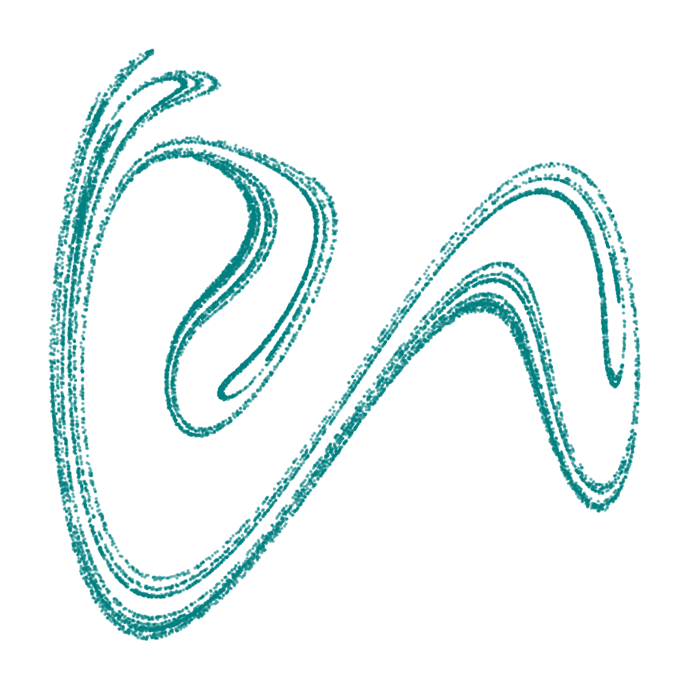

Research Fellow in [machine learning for physical systems](https://www.gla.ac.uk/schools/mathematicsstatistics/research/stats/analytics/machinelearningandai/machinelearningforphysicalsystems/) (not AI) at the University of Glasgow.
I model both engineered systems and the natural environment, using interpretable models to represent knowledge as structure. 
Applications include condition and health monitoring: from rail bridges and wind turbines to peat bogs and woodlands!

## [Research projects]

<!-- Integrating telemetry data with applied mathematics, to improve systems **understanding**.  -->

**[2026] (PI) Uncertainty Quantification for Adaptive Emulators** | w/ [Tim Rogers](https://sheffield.ac.uk/mac/people/mech-eng-academic-staff/timothy-rogers), [Vinny Davies](https://www.gla.ac.uk/schools/mathematicsstatistics/staff/vinnydavies/) | DTnet+ pilot project <!-- [£48k] -->

**[2025] (PI) Scaling Cardiac Models by Super-Resolution** | w/ William Ryan, David Dalton | SoftTMech feasibility project <!-- [£13k] -->

**[2023] (CI) Staffordshire Rail Bridge Digital Twin: Phase III** | w/ [Miguel Bravo Haro](https://www.citystgeorges.ac.uk/about/people/academics/miguel-bravo-haro) | Trimble Fund of Cambridge University <!-- [£25k] -->

**[PhD + Post-doc]** Semi-supervised and population-based structural health monitoring: [planes](https://www.sciencedirect.com/science/article/pii/S0022460X21001449), [trains](https://arxiv.org/abs/2403.17820), [automobiles](https://doi.org/10.48550/arXiv.2204.12404), and [wind turbines](https://arxiv.org/abs/2111.15496). Supervisors: [Keith Worden](https://sheffield.ac.uk/mac/people/mech-eng-academic-staff/keith-worden), [Nikos Dervilis](https://sheffield.ac.uk/mac/people/mech-eng-academic-staff/nikolaos-dervilis), [Mark Girolami](https://www.eng.cam.ac.uk/profiles/mag92)

{width=50%}

## [Bio]

**[May.2024-May.2029] University of Glasgow** | Research Fellow |  [Centre for Data Science](https://www.gla.ac.uk/research/az/datascience/) (2026-2029) [Statistics & Data Analytics](https://www.gla.ac.uk/schools/mathematicsstatistics/research/stats/ai3/) (2024-2026)

**[Sep.2022-May.2024] University of Cambridge** | Research Associate | [Computational Statistics and Machine Learning Group](https://csml-cam.github.io) | Department of Engineering

**[Jul.2021-Sep.2022] The Alan Turing Institute** | Research Associate | [Data-Centric Engineering](https://www.turing.ac.uk/research/research-programmes/data-centric-engineering)

**[Sep.2016-Jun.2021] University of Sheffield** | Research Assistant (2019-2021) PhD Student (2016-2019) | [Dynamics Research Group](https://drg.ac.uk/) | Department of Engineering

### [PhD supervision]

- **Caitlin Castelvecchi:** Probabilistic smart sensing for environmental monitoring [w/ [Claire Miller](https://www.gla.ac.uk/schools/mathematicsstatistics/staff/clairemiller/), [Craig Wilkie](https://www.gla.ac.uk/schools/mathematicsstatistics/staff/craigwilkie/), [Abdollah Jalilian](https://www.gla.ac.uk/schools/mathematicsstatistics/staff/abdollahjalilian/)]
- **Alasdair Pool:** Multiscale modelling of peat bogs [w/ [Raimondo Penta](https://regii1.wordpress.com/2025/07/04/raimondo-penta/), [Vinny Davies](https://www.gla.ac.uk/schools/mathematicsstatistics/staff/vinnydavies/)]
- **Daniel Clarkson:** Active learning for engineering fleets [w/ [Nikos Dervilis](https://sheffield.ac.uk/mac/people/mech-eng-academic-staff/nikolaos-dervilis), [Keith Worden](https://sheffield.ac.uk/mac/people/mech-eng-academic-staff/keith-worden)]
- **Sarah Bee**: Multi-task learning for structural health monitoring [w/ [Nikos Dervilis](https://sheffield.ac.uk/mac/people/mech-eng-academic-staff/nikolaos-dervilis), [Keith Worden](https://sheffield.ac.uk/mac/people/mech-eng-academic-staff/keith-worden)]

## [External standing]

Engineer at the data-centric engineering consultancy [AQ](https://aq.live/), Editor for the [Data-Centric Engineering](https://www.cambridge.org/core/journals/data-centric-engineering) journal, and member of [Statistical Engineering Group](https://rss.org.uk/membership/rss-groups-and-committees/special-interest-groups/statistical-engineering/) of the Royal Statistical Society.
Previously on the [Early-Career Academic and Professionals Panel](https://www-smartinfrastructure.eng.cam.ac.uk/news/csic-call-applicants-early-career-academics-and-professionals-panel) (2021-2023) for the [Cambridge Centre for Smart Infrastructure and Construction](https://www-smartinfrastructure.eng.cam.ac.uk/) (CSIC).

 

 

[github](https://github.com/labull)

[google scholar](https://scholar.google.com/citations?user=Lszt1B4AAAAJ&hl=en)

[research gate](https://www.researchgate.net/profile/Lawrence-Bull-2)

[LinkedIn](https://www.linkedin.com/in/lawrence-bull-793178109/)

[orcid](https://orcid.org/0000-0002-0225-5010)

